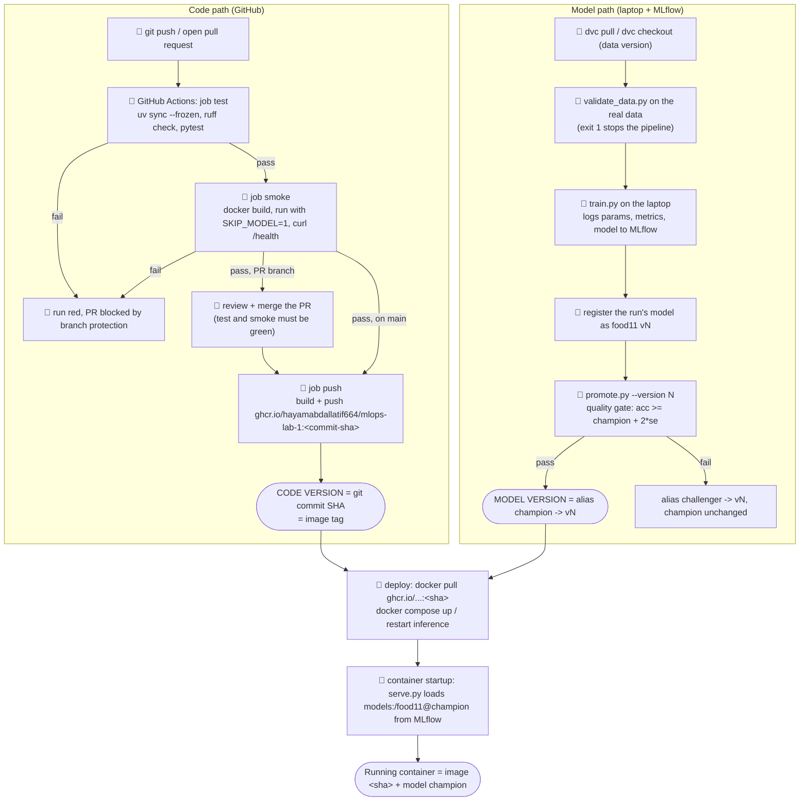

# Lab 5 - The pipeline from `git push` to a running container

Legend: 🤖 = automatic, 👤 = needs a human. The two places where a version is decided are marked **CODE VERSION** and **MODEL VERSION**.

## What is automatic and what still needs a human

| step | automatic? | where the version is decided |
|---|---|---|
| lint, unit tests, API test with a fake model (`test`) | 🤖 on every push and PR | |
| build the image and check it starts (`smoke`) | 🤖 after `test` passes | |
| merge to `main` | 👤 a reviewer, only possible when `test` and `smoke` are green (branch protection) | **code version**: the commit that lands on `main` |
| push the image to GHCR (`push`) | 🤖 only on `main` | the image tag **is** the commit SHA |
| get the data (`dvc pull`) and validate it (`validate_data.py`) | 👤 on the laptop (the runner has no access to the data) | the data version = `data.dvc` in that commit |
| train, register a version | 👤 on the laptop (no GPU and no data in CI) | |
| apply the quality gate (`promote.py`) | 👤 run by hand today; could be automatic if MLflow were reachable from CI (e.g. DagsHub's hosted MLflow) | **model version**: the `champion` alias |
| deploy (pull image, restart `inference`) | 👤 | the container combines image `<sha>` + model `@champion` at startup |

The image and the model are released independently. A new commit produces a new image without touching the model, and moving `champion` changes the served model without rebuilding the image (only a restart of `inference` is needed, Lab 4 Q8).
